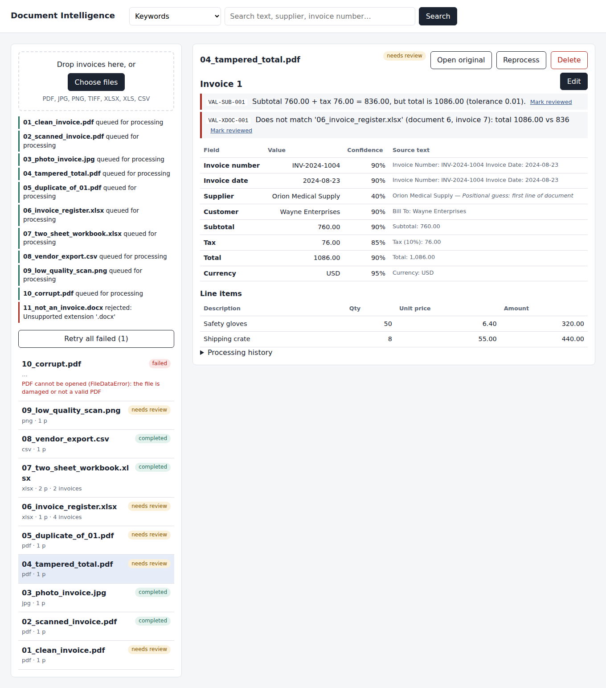
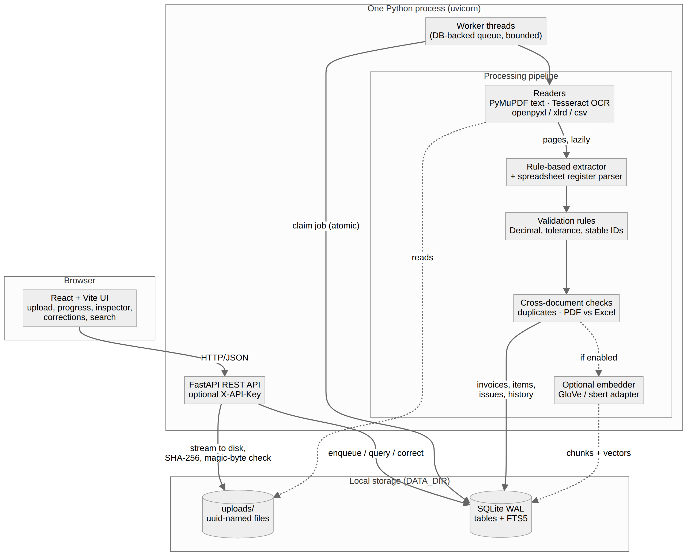

# Document Intelligence System

Upload invoices (PDF, JPG, PNG, TIFF, XLSX, XLS, CSV) → read text or OCR → extract structured fields → validate deterministically → review, correct and search. CPU-only, no paid API, no LLM at run time.
Built for the Care Guide *Senior AI Engineer* assessment. **Status and honest limits: see [Known limitations](#known-limitations) and `docs/COMPLIANCE.md`.**



## Features
- **Documents:** multi-file upload; digital PDFs (text layer), scanned PDFs/images/multi-frame TIFF (Tesseract OCR), XLSX/XLS (all sheets), CSV (delimiter detection); one-invoice-per-row Excel *registers*; multi-invoice files; corrupt/encrypted/empty/unsupported files handled with clear errors.
- **Extraction:** invoice number, date, supplier, customer, subtotal, tax, total, currency, line items, as JSON. Missing or ambiguous values stay empty (an ambiguous `03/04/2024` is not guessed). Each value has its source text and a heuristic confidence plus the weakest OCR word confidence.
- **Validation** (stable rule IDs, `Decimal`, per-currency precision, configurable tolerance): required/invalid fields, dates, currencies, subtotal+tax=total, line arithmetic, duplicates, low OCR confidence, PDF↔PDF and PDF↔Excel cross-verification. Catalogue: `GET /api/rules`.
- **Review:** inline corrections with audit trail and automatic re-validation, “mark reviewed”, open the original file, reprocess, retry failed jobs, delete.
- **Search:** keyword (SQLite FTS5 + filters); optional meaning-based hybrid search.
- **Background processing:** DB-backed worker with progress, retry/backoff, atomic job claim, restart recovery, duplicate-upload protection; page-streaming so memory does not grow with page count.

## Architecture


FastAPI + SQLite (WAL, FTS5) + PyMuPDF + Tesseract + React/Vite, one process. Details, trade-offs and failure modes: [docs/ARCHITECTURE.md](docs/ARCHITECTURE.md). Schema/ERD: [docs/DATABASE.md](docs/DATABASE.md). API contract: [docs/openapi.json](docs/openapi.json) (live at `/docs`). Security: [docs/SECURITY.md](docs/SECURITY.md).

## Quick start (Windows PowerShell; commands were run on Linux, **not yet verified on Windows**)
Prerequisites: Python 3.11+ (tested 3.12), Node 20+ (tested 22), [Tesseract OCR 5](https://github.com/UB-Mannheim/tesseract/wiki) (English). If `tesseract` is not on PATH: `$env:TESSERACT_CMD = "C:\Program Files\Tesseract-OCR\tesseract.exe"`.
```powershell
cd backend
python -m venv .venv; .\.venv\Scripts\Activate.ps1
pip install -r requirements-dev.txt
python -m uvicorn app.main:app --host 127.0.0.1 --port 8000      # API + background worker
```
New terminal:
```powershell
cd frontend; npm install; npm run dev                              # http://localhost:5173 (proxies /api to :8000)
```
Data (SQLite file + uploads) lives in `backend/data/` (`DOCINTEL_DATA_DIR`). The schema is created and migrated automatically on start; there is nothing else to set up. Demo files: `python scripts\seed_demo.py` → `demo_files\`.
On Linux/macOS use `source .venv/bin/activate` and `export` instead of `$env:`.

## Configuration (environment variables)
| variable | default | meaning |
|---|---|---|
| `DOCINTEL_DATA_DIR` | `./data` | database and uploads |
| `DOCINTEL_API_KEY` | unset (open) | if set, every endpoint except `/api/health` requires header `X-API-Key` |
| `DOCINTEL_CORS_ORIGINS` | Vite dev origins | comma-separated allowed origins |
| `DOCINTEL_MAX_UPLOAD_MB` | 200 | per-file upload limit |
| `DOCINTEL_WORKERS` | 1 | background worker threads |
| `DOCINTEL_MAX_ATTEMPTS` / `DOCINTEL_RETRY_BACKOFF_S` | 3 / 2 | retries for transient errors |
| `DOCINTEL_OCR_DPI` / `_OCR_LANG` / `_OCR_TIMEOUT_S` | 200 / eng / 90 | OCR rendering and limits |
| `DOCINTEL_OCR_THREADS` | 1 | pages OCR'd concurrently (memory ≈ +80–100 MB each) |
| `DOCINTEL_TESS_OMP_THREADS` | 1 | threads per Tesseract process (0 = Tesseract default) |
| `DOCINTEL_PDF_STORE_SHRINK` | 1 | flush MuPDF image cache per OCR page (halves peak memory) |
| `DOCINTEL_OCR_FIELD_MIN_CONF` | 60 | flag values whose weakest OCR word is below this (0 disables) |
| `DOCINTEL_TOLERANCE_MINOR_UNITS` | 1 | rounding tolerance in minor currency units |
| `DOCINTEL_SEMANTIC` | off | `off` / `glove` / `sbert`; see `docs/SEMANTIC.md` |
| `DOCINTEL_MODELS_DIR`, `DOCINTEL_GLOVE_VOCAB`, `DOCINTEL_SBERT_MODEL`, `DOCINTEL_CHUNK_CHARS` | – | semantic-search model location/size/chunking |
| `TESSERACT_CMD` | `tesseract` | path to the Tesseract executable |

## API
Full contract: [docs/openapi.json](docs/openapi.json). Main endpoints:
| method | path | purpose |
|---|---|---|
| POST | `/api/documents` | multi-file upload (multipart `files`); per-file result `queued` / `duplicate` / `rejected` |
| GET | `/api/documents`, `/api/documents/{id}` | list with job progress; detail (invoices paginated: `invoice_limit`, `invoice_offset`) |
| GET | `/api/documents/{id}/file` | the original upload (for review) |
| POST | `/api/documents/{id}/reprocess` · DELETE `/api/documents/{id}` | re-run extraction · delete everything about a document |
| GET · POST | `/api/jobs?status=failed` · `/api/jobs/retry-failed` | failed-job inspection and re-queue |
| GET · PATCH | `/api/invoices/{id}` | read / correct fields and line items (audited, re-validated) |
| GET | `/api/invoices/{id}/corrections` | audit trail |
| POST | `/api/issues/{id}/resolve` | mark a warning/error reviewed |
| GET | `/api/search?q=&supplier=&customer=&currency=&status=&review=&date_from=&date_to=` | keyword search + filters |
| GET | `/api/search/semantic?q=&mode=hybrid\|semantic` · `/api/semantic/status` · POST `/api/semantic/reindex` | optional meaning-based search |
| GET | `/api/rules` · `/api/health` | rule catalogue · health |

```http
PATCH /api/invoices/12
{"fields": {"total": "1,234.50"}, "line_items": [{"idx": 2, "quantity": "7"}, {"description": "Freight", "amount": "40"}], "note": "OCR misread"}
```

## Tests
```powershell
cd backend; python -m pytest tests -q          # 124 tests in ~20 s on the development sandbox
```
Covers file readers and OCR for every type, corrupt/encrypted/unsupported files, extraction, every validation rule, duplicate and cross-document checks, corrections, the worker (retry, atomic claim, recovery), API endpoints, security controls, semantic search (fake embedder), and OCR-confidence flagging. Key tests were mutation-checked (they fail when the production code is deliberately broken). Recorded run: `docs/test-results/day2-pytest.txt` (**Linux sandbox; not yet run on Windows**).

## Evaluation and benchmarks (all measured; sandbox = 1 CPU core, 4 GB RAM)
- **Extraction accuracy** on labeled **synthetic** invoices (three layouts, all seven file types, degraded scans, missing/ambiguous fields, tampered totals, cross-document pairs, 18 broken files): header-field exact match 99.4–99.5% on two held-out splits (199 invoices each), line items ≈ 98–99%, 100% of valid files processed, 18/18 broken files handled. **These are upper bounds: the data share an author with the extractor and no real invoices were used.** Methodology, per-file-type tables, calibration and limits: [docs/evaluation/EVALUATION.md](docs/evaluation/EVALUATION.md).
- **Large documents:** 1,000-page digital PDF in ~3.7 s (176 MB); 1,000-page scanned PDF in ~430 s (~140 pages/min), Python peak ~217 MB, no failures; API stayed responsive during OCR. Tables and method: [docs/benchmarks/RESULTS.md](docs/benchmarks/RESULTS.md). **Not yet measured on the target Windows / 8 GB machine**: run [docs/benchmarks/WINDOWS_RUNBOOK.md](docs/benchmarks/WINDOWS_RUNBOOK.md).
- Reproduce: `python eval/make_dataset.py --split test; python eval/run_eval.py --split test; python eval/report_eval.py` and `python eval/bench.py run --kind scanned --pages 100`.

## Optional semantic search
Off by default (`DOCINTEL_SEMANTIC=glove` after `python -m app.semantic download-glove`, run in `backend/`). Hybrid keyword+meaning ranking over a small local word-vector model; measured cost and quality, and why it is optional: [docs/SEMANTIC.md](docs/SEMANTIC.md).

## Demo
Script for the recorded walkthrough: [docs/DEMO_SCRIPT.md](docs/DEMO_SCRIPT.md). Screenshots (from a real run): `docs/screenshots/`.

## Known limitations
- Evaluation data are synthetic; real-world accuracy is unknown and likely lower on unseen layouts, wrapped tables, discounts/shipping lines, tax-inclusive totals and noisy scans. No LLM extraction.
- Confidence scores are heuristic, not calibrated probabilities; 33–88% of extraction errors were flagged for review in the evaluation (depending on split/rule), the rest passed silently.
- Not tested on Windows; performance numbers are from a 1-core Linux sandbox. Multi-core scaling is unmeasured.
- Single-tenant: one optional shared API key, no users/roles, no TLS or encryption at rest, parsers are not sandboxed (see docs/SECURITY.md).
- SQLite single-process design; PostgreSQL/pgvector and a real queue would be the next step beyond roughly 250k vector chunks or multiple server processes.
- Cross-document verification compares header values only (not line items); English-language OCR only.

## Repository layout
`backend/app` (service) · `backend/tests` · `backend/synth` (synthetic invoice generators) · `frontend/` (React + Vite) · `eval/` (dataset, evaluation, benchmarks) · `scripts/` (demo data, docs generators) · `docs/` (architecture, database, security, evaluation, benchmarks, demo, screenshots) · `PROGRESS.md` · `AI_PROMPTS.md`.
