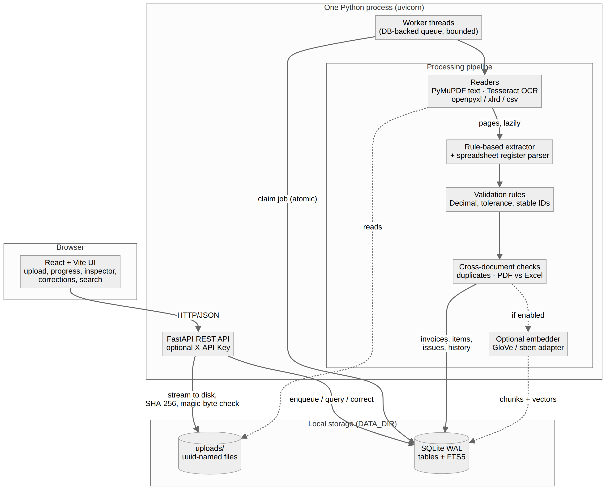
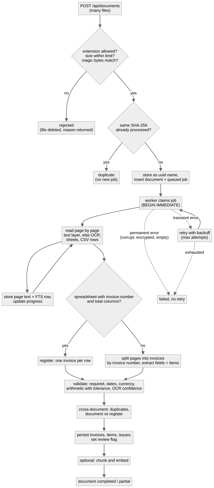
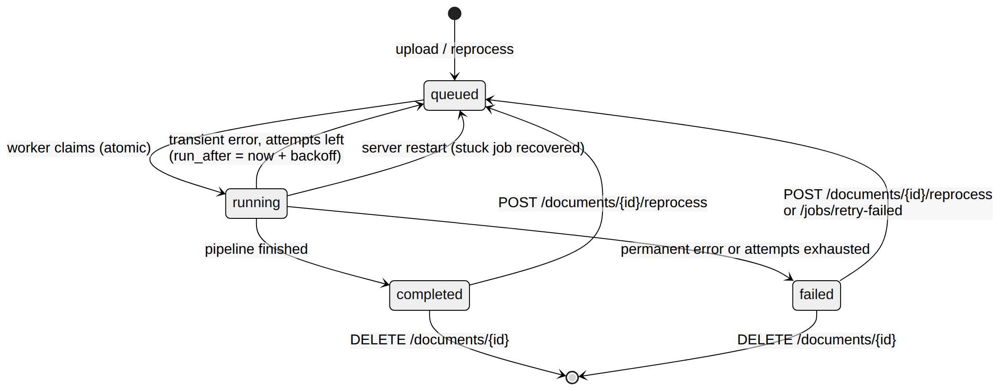

# Architecture

_Diagram sources: `docs/diagrams/*.mmd` (Mermaid); rendered by `scripts/render_diagrams.py`. Database schema and ERD: [DATABASE.md](DATABASE.md). API contract: [openapi.json](openapi.json) (also served at `/docs`)._

## 1. What it is
One cohesive Python service (FastAPI) with an in-process background worker, a SQLite database and a React UI. No external services: it runs on a single 8 GB Windows laptop, CPU only.
Deterministic, rule-based extraction is the baseline and the only extraction path; **the application never calls an LLM or any paid API**.

## 2. Request and processing flow

1. **Upload** (`POST /api/documents`, many files): each file is checked independently (extension allow-list, streamed size limit, magic bytes vs extension), hashed (SHA-256) and stored under a random name. Identical bytes are not processed twice. A queued job is created.
2. **Worker** claims the job atomically and reads the file **page by page** (generator): text layer via PyMuPDF, otherwise render at 200 dpi and OCR with Tesseract; spreadsheets sheet by sheet; CSV with delimiter detection. Each page is committed (progress is visible; a crash loses at most one page of work).
3. **Extraction**: a spreadsheet with invoice-number and total columns is a *register* (one invoice per row); otherwise pages are split into invoices wherever the invoice number changes and fields/line items are extracted with rules. Every value keeps its source line, a heuristic confidence, and (for OCR) the weakest word confidence.
4. **Validation** (deterministic, stable rule IDs, `Decimal`, per-currency precision and tolerance), then **cross-document checks** (duplicates; PDF/image vs Excel verification).
5. Results, issues and history are persisted; the document is `completed`, `partial` (some pages failed) or `failed`. A reviewer inspects, corrects (audited, re-validated), marks warnings reviewed, searches, reprocesses or deletes.

## 3. Module map (`backend/app/`)
| module | responsibility |
|---|---|
| `main.py` | REST API, auth (optional API key), upload hardening, search endpoints, file serving |
| `worker.py` | DB-backed queue: atomic claim, retry with exponential backoff, stuck-job recovery, bounded worker threads |
| `pipeline.py` | orchestrates read → store → extract → validate → cross-check → persist (+ optional embedding) |
| `readers.py` | file-type detection and lazy readers (PDF text/OCR, images/TIFF, XLSX, XLS, CSV); bounded memory |
| `extract.py` | rule-based invoice extractor, invoice splitter, spreadsheet register parser, OCR confidence attachment |
| `validate.py` | rule engine (`RULES` catalogue at `/api/rules`) |
| `review.py` | duplicate and cross-document verification, issue persistence, re-validation |
| `corrections.py` | audited manual corrections, "mark reviewed" |
| `semantic.py` | optional embeddings, chunk store, brute-force cosine index, hybrid ranking |
| `db.py`, `config.py`, `money.py`, `errors.py` | schema/migration, settings (env), decimal/currency helpers, error classes |

## 4. Main design decisions and trade-offs
| decision | why | cost / limit |
|---|---|---|
| SQLite (WAL, FTS5) instead of PostgreSQL + pgvector | nothing to install or run; fits the 8 GB CPU-only constraint; keyword search and brute-force vectors are fast enough at this scale (measured) | single writer process; no horizontal scaling. Move to PostgreSQL/pgvector when chunk counts pass ~250k–1M or several API/worker processes are needed |
| DB-backed worker threads instead of Redis/Celery | one process, atomic claim in SQL, survives restarts (stuck jobs requeued) | workers share the API process (OCR runs in Tesseract subprocesses, so API stays responsive; measured p95 20 ms during a scan); not a distributed queue |
| Rules first, no LLM | reliable, explainable, free, offline; every value has evidence | brittle on unseen layouts; accuracy on real invoices is unmeasured (see EVALUATION.md) |
| Page-streaming + bounded OCR concurrency | memory independent of page count (measured flat to 1,000 scanned pages) | OCR throughput bound by CPU: ~125–140 pages/min on one sandbox core |
| MuPDF cache flush + Tesseract thread cap | halved peak memory (502 → 249 MB at 100 pages); 1.7× faster on one core | the thread-cap benefit on multi-core CPUs is unmeasured |
| Money as `Decimal` strings, tolerance per currency | no float rounding errors; JPY/KWD precision handled | tolerance is a global setting (`DOCINTEL_TOLERANCE_MINOR_UNITS`) |
| Review-centric design (evidence, flags, audit, original file) | the system assists a human instead of silently trusting OCR | a person is still needed for flagged invoices. In the synthetic evaluation 0–2.7% of clean invoices were flagged and 33–88% of extraction errors were caught (depending on split and rule); the rest of the errors passed silently |
| Optional hybrid semantic search | adds paraphrase matching without a heavy model; keyword stays authoritative | modest quality (see SEMANTIC.md); off by default |

## 5. Failure modes and how they are handled
| situation | behaviour |
|---|---|
| unsupported / empty / mislabeled file, over the size limit | rejected at upload with a reason; nothing stored |
| corrupt, truncated or encrypted file; blank image | job `failed` with an error code (`corrupt_file`, `encrypted_file`, `no_extractable_content`); **not retried** |
| a page fails (e.g. OCR timeout) | page marked failed, other pages continue; document `partial` |
| transient error (I/O etc.) | retried with exponential backoff, up to `DOCINTEL_MAX_ATTEMPTS`; then `failed` |
| server stops mid-job | on start, `running` jobs are re-queued |
| identical file uploaded again | reported as `duplicate`; no new job (failed documents can be re-uploaded or reprocessed) |
| duplicate / conflicting invoice across files | flagged on **both** files (`VAL-DUP-001`, `VAL-XDOC-001`) |
| embedding/semantic failure | logged as an event; the document still completes |
| reprocess / delete | related documents' duplicate and cross-check flags are refreshed |
| **untested here:** disk full, SQLite lock contention under many concurrent writers, very large uploads over a slow link | not exercised |

## 6. Scalability evidence (sandbox: 1 core, 4 GB; see `docs/benchmarks/RESULTS.md`)
- 1,000-page **digital** PDF: ~3.7 s, 176 MB peak. 1,000-page **scanned** PDF: 429.6 s (139.7 pages/min), Python process peak 217 MB, 0 failures. Memory does not grow with page count; text-heavy pages are several times slower.
- Cross-document matching: 1,000 + 1,000 duplicate invoices and a 5,000-row register processed in ~7 s each, memory < 190 MB.
- Keyword search is SQLite FTS5; semantic brute force ~10 ms at 100k chunks.
- **Not measured:** the target Windows / 8 GB machine, concurrent users, multi-core scaling, files above ~110 MB.

## 7. What changes for production
PostgreSQL + pgvector (or another vector index), a real queue and separate worker processes, object storage for uploads, per-user authentication and roles, TLS termination, structured logs/metrics/tracing, parser sandboxing, backups and retention policy. See [SECURITY.md](SECURITY.md) for the security gaps.
