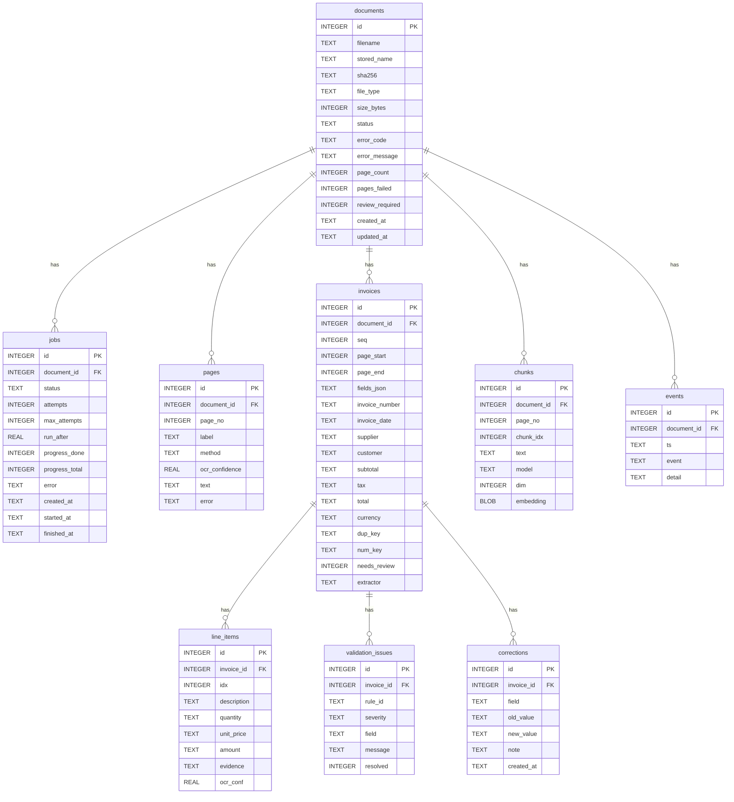

# Database schema

_Generated by `scripts/gen_schema_doc.py` from the real schema (`backend/app/db.py`). SQLite in WAL mode; one short transaction per unit of work._

## Entity-relationship diagram

`page_fts` is an FTS5 virtual table (`text`, plus unindexed `document_id`, `page_no`; Porter stemming) that powers keyword search. SQLite cannot cascade deletes into it, so the API removes its rows explicitly.

## Tables

### `documents`

One row per uploaded file: name, SHA-256 (duplicate-upload protection), detected type, status, page counters, error code/message, review flag.

| column | type | notes |
|---|---|---|
| id | INTEGER | primary key |
| filename | TEXT | NOT NULL |
| stored_name | TEXT | NOT NULL |
| sha256 | TEXT | NOT NULL |
| file_type | TEXT |  |
| size_bytes | INTEGER | NOT NULL |
| status | TEXT | NOT NULL, default 'queued' |
| error_code | TEXT |  |
| error_message | TEXT |  |
| page_count | INTEGER |  |
| pages_failed | INTEGER | NOT NULL, default 0 |
| review_required | INTEGER | NOT NULL, default 0 |
| created_at | TEXT | NOT NULL |
| updated_at | TEXT | NOT NULL |

Indexes: `ix_documents_status` (status), `ix_documents_sha` (sha256)

### `jobs`

Background-processing queue and history: status, attempts/max_attempts, `run_after` (retry backoff), progress counters. A document can have several jobs (reprocessing).

| column | type | notes |
|---|---|---|
| id | INTEGER | primary key |
| document_id | INTEGER | → documents.id (ON DELETE CASCADE), NOT NULL |
| status | TEXT | NOT NULL, default 'queued' |
| attempts | INTEGER | NOT NULL, default 0 |
| max_attempts | INTEGER | NOT NULL |
| run_after | REAL | NOT NULL, default 0 |
| progress_done | INTEGER | NOT NULL, default 0 |
| progress_total | INTEGER |  |
| error | TEXT |  |
| created_at | TEXT | NOT NULL |
| started_at | TEXT |  |
| finished_at | TEXT |  |

Indexes: `ix_jobs_claim` (status, run_after)

### `pages`

Extracted text per page/sheet with the method used (text layer, OCR, sheet, csv) and OCR mean confidence. Failed pages are kept with their error.

| column | type | notes |
|---|---|---|
| id | INTEGER | primary key |
| document_id | INTEGER | → documents.id (ON DELETE CASCADE), NOT NULL |
| page_no | INTEGER | NOT NULL |
| label | TEXT |  |
| method | TEXT |  |
| ocr_confidence | REAL |  |
| text | TEXT |  |
| error | TEXT |  |

### `invoices`

One row per invoice found in a document (a PDF or workbook can hold many). `fields_json` keeps the full extraction (value, confidence, evidence, OCR word confidence); the plain columns are the current values used for search/filters. `num_key` = normalised invoice number for cross-document matching.

| column | type | notes |
|---|---|---|
| id | INTEGER | primary key |
| document_id | INTEGER | → documents.id (ON DELETE CASCADE), NOT NULL |
| seq | INTEGER | NOT NULL |
| page_start | INTEGER | NOT NULL |
| page_end | INTEGER | NOT NULL |
| fields_json | TEXT | NOT NULL |
| invoice_number | TEXT |  |
| invoice_date | TEXT |  |
| supplier | TEXT |  |
| customer | TEXT |  |
| subtotal | TEXT |  |
| tax | TEXT |  |
| total | TEXT |  |
| currency | TEXT |  |
| dup_key | TEXT |  |
| num_key | TEXT |  |
| needs_review | INTEGER | NOT NULL, default 0 |
| extractor | TEXT | NOT NULL |

Indexes: `ix_invoices_numkey` (num_key), `ix_invoices_dup` (dup_key), `ix_invoices_doc` (document_id)

### `line_items`

Line items of an invoice (values kept as decimal strings); `evidence` is the source line; `ocr_conf` the weakest OCR word (cleared when a human edits the row).

| column | type | notes |
|---|---|---|
| id | INTEGER | primary key |
| invoice_id | INTEGER | → invoices.id (ON DELETE CASCADE), NOT NULL |
| idx | INTEGER | NOT NULL |
| description | TEXT |  |
| quantity | TEXT |  |
| unit_price | TEXT |  |
| amount | TEXT |  |
| evidence | TEXT |  |
| ocr_conf | REAL |  |

### `validation_issues`

Output of the deterministic rule engine, one row per finding with a stable `rule_id`; `resolved` marks human review.

| column | type | notes |
|---|---|---|
| id | INTEGER | primary key |
| invoice_id | INTEGER | → invoices.id (ON DELETE CASCADE), NOT NULL |
| rule_id | TEXT | NOT NULL |
| severity | TEXT | NOT NULL |
| field | TEXT |  |
| message | TEXT | NOT NULL |
| resolved | INTEGER | NOT NULL, default 0 |

### `corrections`

Audit trail of manual edits: field, old value, new value, note, timestamp.

| column | type | notes |
|---|---|---|
| id | INTEGER | primary key |
| invoice_id | INTEGER | → invoices.id (ON DELETE CASCADE), NOT NULL |
| field | TEXT | NOT NULL |
| old_value | TEXT |  |
| new_value | TEXT |  |
| note | TEXT |  |
| created_at | TEXT | NOT NULL |

### `chunks`

Optional semantic index: text chunks with an embedding BLOB (float32) and the model name that produced it.

| column | type | notes |
|---|---|---|
| id | INTEGER | primary key |
| document_id | INTEGER | → documents.id (ON DELETE CASCADE), NOT NULL |
| page_no | INTEGER | NOT NULL |
| chunk_idx | INTEGER | NOT NULL |
| text | TEXT | NOT NULL |
| model | TEXT | NOT NULL |
| dim | INTEGER | NOT NULL |
| embedding | BLOB | NOT NULL |

Indexes: `ix_chunks_model` (model), `ix_chunks_doc` (document_id)

### `events`

Processing history per document (uploaded, read_started, page_failed, completed, retry_scheduled, corrected, ...).

| column | type | notes |
|---|---|---|
| id | INTEGER | primary key |
| document_id | INTEGER | → documents.id (ON DELETE CASCADE), NOT NULL |
| ts | TEXT | NOT NULL |
| event | TEXT | NOT NULL |
| detail | TEXT |  |

## Design notes

- **Why SQLite (not PostgreSQL/pgvector) for now:** one cohesive CPU-first deployment, zero services to run on an 8 GB Windows machine. Measured limits and the point where a move is justified are in `docs/SEMANTIC.md` (brute-force vectors up to ~250k chunks) and `docs/benchmarks/`.
- **Money is stored as decimal strings**, never floats; arithmetic uses Python `Decimal` with per-currency precision.
- **Denormalised columns on `invoices`** (number, date, supplier, customer, totals, currency) mirror `fields_json` so search/filters need no JSON parsing; they are updated together by the correction code.
- **Concurrency:** WAL journal, `BEGIN IMMEDIATE` transactions, jobs claimed atomically (`UPDATE … WHERE status='queued'` inside one transaction), so two workers never run the same job.
- **Migrations:** `init_db()` creates missing tables and adds later columns (`invoices.num_key`, `line_items.ocr_conf`) in place; there is no separate migration tool.
- **Deletion:** `DELETE /api/documents/{id}` removes the file, FTS rows and (via cascade) everything derived from it.
